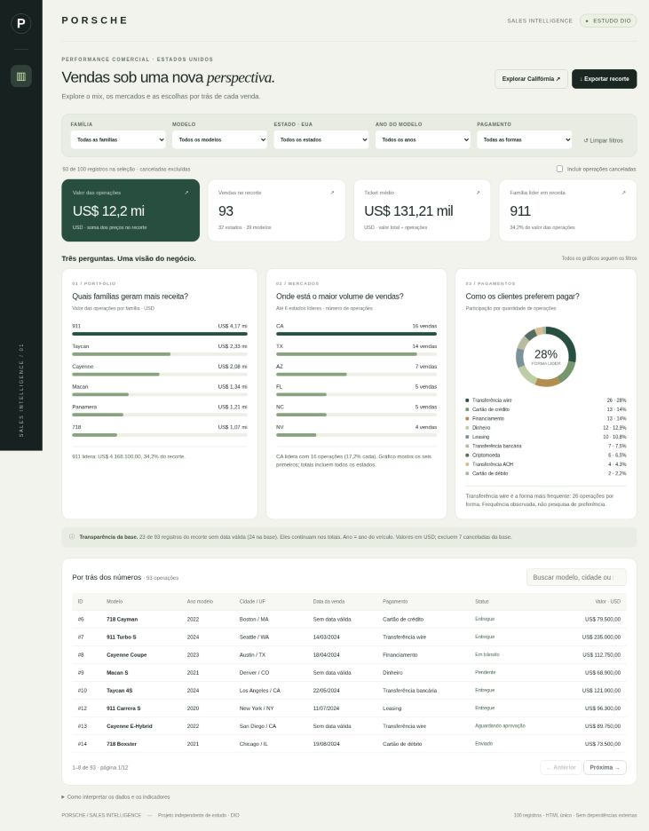
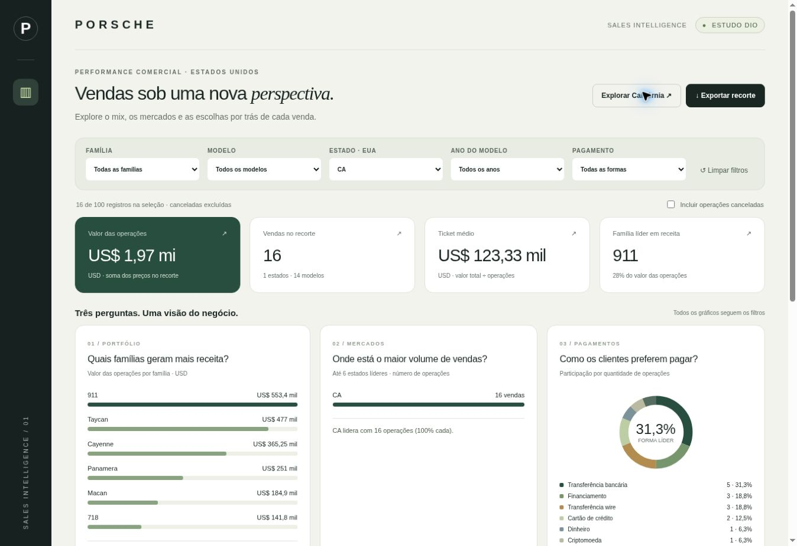

# Porsche Sales Intelligence

Dashboard interativa do desafio DIO: 100 registros de operações Porsche, transformados em perguntas de negócio, filtros e decisões documentadas.

**Publicação:** pendente de criação do repositório público e ativação do GitHub Pages. Nenhum endereço de produção foi verificado ainda. Após publicar, substitua esta linha pelo endereço exibido em Settings → Pages.



## Perguntas de negócio

| Pergunta | Visual | Por que ela importa |
|---|---|---|
| Quais famílias geram mais receita? | Barras de valor por família | Identifica concentração monetária no portfólio; agrupa variantes para facilitar a leitura |
| Onde está o maior volume de vendas? | Ranking dos 6 estados líderes | Compara presença comercial por mercado; a base tem muitas cidades com poucas operações |
| Como os clientes preferem pagar? | Rosca e legenda de quantidade e participação | Mostra o mix observado de meios de pagamento para orientar a operação comercial |

“Preferem” significa frequência observada no conjunto, não uma pesquisa com clientes. “Receita” é a soma dos preços das operações selecionadas, sem equivaler a lucro, recebimento ou receita contábil reconhecida.

No recorte padrão, **93 operações** somam **USD 12.202.550,50**. A família **911** responde por **34,2%** do valor, **CA** lidera com **16 operações**, e **Wire Transfer** aparece em **26 operações**. Essas conclusões descrevem somente a amostra do desafio.

## Exploração

- Filtros combináveis: família, modelo, estado americano, ano do veículo e pagamento.
- Indicadores de valor, quantidade, ticket médio e família líder.
- Canceladas excluídas por padrão, com opção explícita de inclusão.
- Botão de exemplo Califórnia e reset completo.
- Tabela com busca e paginação de 8 linhas; busca afeta tabela/exportação, não os gráficos.
- Exportação CSV das linhas filtradas e buscadas, incluindo todas as páginas.
- Estados vazios e empates tratados, navegação por teclado e layout responsivo.

### Um filtro aplicado

Clique em **Explorar Califórnia ↗**. O painel passa de 93 para **16 operações**, com **USD 1.973.350,00**. Esse recorte mantém 5 registros sem data válida nos totais.



## Como foi construído

A implementação foi realizada com IA no **ChatGPT Work**, usando análise do anexo e as orientações das skills de planilhas e Sites. Não foi usado Canvas nem criado um agente pessoal com skill própria; não foi executada comparação entre dois agentes. O [briefing e os refinamentos](docs/prompts.md) registram o prompt consolidado e as decisões reais da sessão.

O visual usa marfim, verde escuro, sálvia e dourado, com tipografia sans-serif do sistema e detalhe serifado no título. Não depende de Google Fonts, CDN ou bibliotecas de gráficos. Barras em HTML/CSS e rosca SVG são calculadas a partir do recorte ativo. Dados, CSS e JavaScript ficam embutidos em um único [index.html](index.html), que abre também offline.

## Base e tratamento

O anexo `base_vendas_porches.csv` tinha conteúdo **XLSX**, apesar da extensão. Foram extraídas somente as colunas sanitizadas, convertidos ano/preço/quilometragem em números, preservadas 24 datas inválidas como nulas e identificados 7 cancelamentos. Nomes de clientes e vendedores e colunas cruas foram removidos dos arquivos públicos. Nenhuma fórmula é usada no painel.

Os valores estão em **USD**, moeda presente na base; cidades e estados são dos **EUA**. O filtro de ano é o **ano do veículo**, não o ano da venda. As datas futuras e inválidas da base educacional não são corrigidas por suposição. Veja o [tratamento e dicionário de dados](docs/tratamento.md).

- [Dados sanitizados em CSV](data/sales.csv)
- [Dados sanitizados em JSON](data/sales.json)
- [Script de preparação](scripts/prepare_data.py)
- [Script de validação](scripts/validate.py)
- [Resultados dos testes](docs/validacao.md)

Fonte do enunciado: [planilha disponibilizada pela DIO](https://hermes.dio.me/files/assets/8683bed0-cc33-4e06-bca9-04db9c31f9e2.xlsx). A fonte efetivamente usada foi o anexo recebido nesta sessão, não uma cópia baixada desse endereço.

## Executar e validar

Abra `index.html` em um navegador com JavaScript ativado. Não é necessário instalar pacotes, compilar ou subir uma API.

```bash
python scripts/validate.py
```

A validação confere os 100 registros, identidade entre JSON público e dados embutidos, ausência dos campos pessoais, conversões numéricas, valores monetários, evidências e links locais do README.

## Publicar no GitHub Pages

1. Crie um repositório **público** na sua conta, com nome `porsche-sales-dashboard`.
2. Envie os arquivos deste projeto, com `index.html` na raiz. Preserve `data/`, `docs/` e `scripts/`; não envie o anexo original.
3. Em **Settings → Pages**, escolha **Deploy from a branch**, branch **main** e pasta **/(root)**; salve.
4. Aguarde a implantação, abra o endereço apresentado pelo GitHub e teste o botão Califórnia e os filtros.
5. Atualize a linha de publicação deste README com o endereço confirmado. Na submissão DIO, envie o endereço do **repositório**, não apenas o da dashboard.

Referência: [configurar a origem de publicação — GitHub Docs](https://docs.github.com/en/pages/getting-started-with-github-pages/configuring-a-publishing-source-for-your-github-pages-site).

## Limites e próximos experimentos

Não existem dados de custo, margem ou fluxo de caixa; não se podem inferir lucratividade nem vendas reais de toda a marca. Wire Transfer e Bank Transfer são categorias diferentes nesta entrega. A análise não inclui regressão, previsão ou comparação temporal, dado o tamanho e a qualidade das datas.

Para evoluir o aprendizado: compare ranking por volume com ranking por ticket médio; experimente uma regra explícita para consolidar transferências; reexecute o mesmo briefing no Canvas e documente as diferenças. Esses experimentos ficam como próximos passos, não como funcionalidades já entregues.

Projeto independente e educacional. Sem afiliação ou integração oficial com a Porsche.
